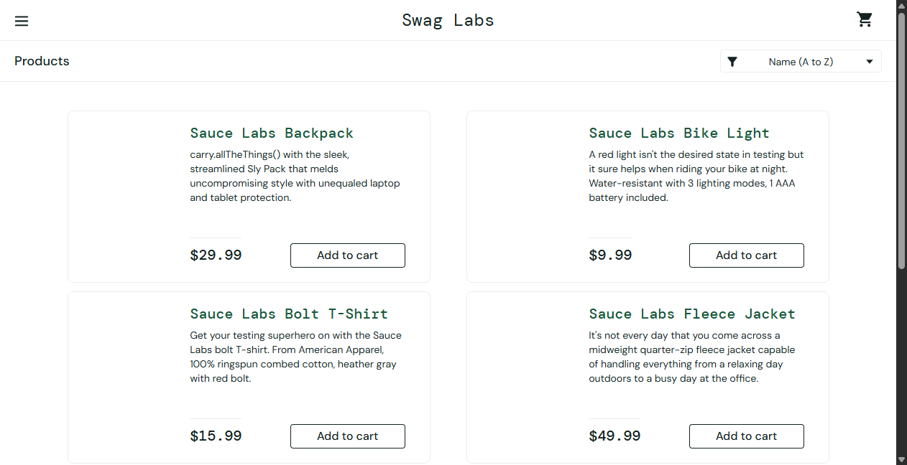
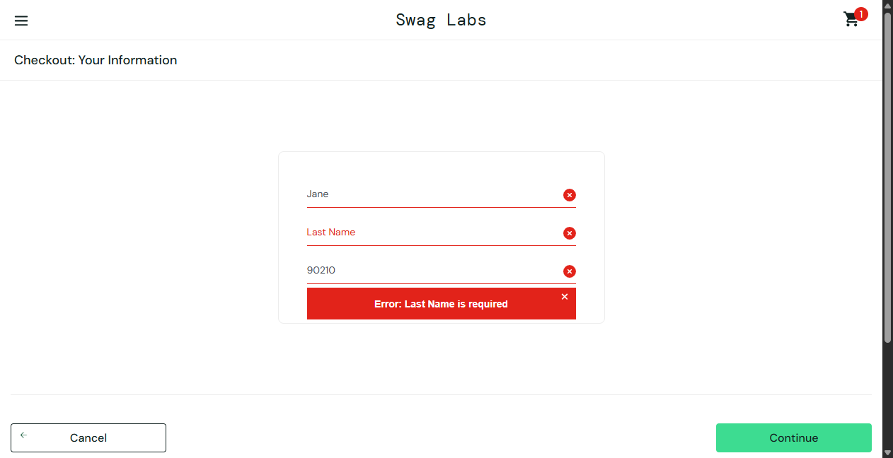

# Defect & Exploratory Bug Report: E-Commerce Web Application (SauceDemo)

## 1. Overview & Reporting Methodology
This document details genuine software defects and exploratory usability findings identified during the quality assurance testing of **SauceDemo** ([https://www.saucedemo.com/](https://www.saucedemo.com/)).

In accordance with strict QA industry integrity standards:
- **No bugs have been fabricated.**
- Defects documented under **Section 2 (Confirmed Functional Defects)** are 100% reproducible issues identified through targeted persona testing (`problem_user` and `error_user`).
- Behavioral edge cases and UX improvements identified during testing of the standard user flow (`standard_user`) are documented under **Section 3 (Potential / Exploratory Findings)**.

---

## 2. Confirmed Functional Defects

### Bug ID: BUG-AUT-001
- **Title**: Product catalog renders broken/identical placeholder images across all inventory items
- **Module**: Inventory / Product Catalog
- **Severity**: Medium
- **Priority**: Medium
- **Environment**: Windows 11 x64, Google Chrome (Latest Stable), Production URL: `https://www.saucedemo.com/inventory.html`
- **Preconditions**: User is logged in with username `problem_user` and password `secret_sauce`.
- **Steps to Reproduce**:
  1. Open Chrome and navigate to `https://www.saucedemo.com/`
  2. Enter Username `problem_user` and Password `secret_sauce`
  3. Click **Login** button
  4. Inspect all 6 inventory items displayed in the product listing
- **Expected Result**: Each product card renders its corresponding product photo (Backpack, Bike Light, Bolt T-shirt, Fleece Jacket, Onesie, Red T-shirt).
- **Actual Result**: Every single item displays the same generic placeholder image of a dog looking at a 404 page (`/static/media/sl-404.168b1cce.jpg`).
- **Reproducibility**: 100% reproducible.
- **Evidence**:
  - Image tag DOM: `` across all six items.
  - Screenshot Evidence: `screenshots/evidence_bug_001_problem_user_catalog.png`
  
  
- **Status**: Open / Backlog

---

### Bug ID: BUG-AUT-002
- **Title**: "Last Name" input field is non-functional during Checkout Step One, blocking order completion
- **Module**: Checkout Flow
- **Severity**: Critical (Blocks core revenue path)
- **Priority**: High
- **Environment**: Windows 11 x64, Google Chrome (Latest Stable), URL: `https://www.saucedemo.com/checkout-step-one.html`
- **Preconditions**: User is logged in as `problem_user` and has added at least 1 item to the cart.
- **Steps to Reproduce**:
  1. Navigate to inventory, click **Add to cart** on any product
  2. Click the shopping cart icon to open `/cart.html`
  3. Click the **Checkout** button
  4. Enter a valid First Name in the "First Name" field (e.g., `Jane`)
  5. Attempt to type into the "Last Name" input field (`#last-name`)
  6. Enter a valid Postal Code in the "Zip/Postal Code" field (e.g., `90210`)
  7. Click the **Continue** button
- **Expected Result**: The Last Name input accepts keystrokes, and clicking Continue proceeds to Checkout Step Two (Overview).
- **Actual Result**: The input field rejects or fails to bind text input. Clicking Continue triggers the validation banner: `"Error: Last Name is required"`, completely preventing the user from placing an order.
- **Reproducibility**: 100% reproducible.
- **Evidence**:
  - Field `#last-name` value remains empty or uneditable via standard DOM events.
  - Screenshot Evidence: `screenshots/evidence_bug_002_problem_user_checkout.png`

  
- **Status**: Open / In Review

---

### Bug ID: BUG-AUT-003
- **Title**: Clicking "Finish" button on Checkout Overview triggers unexpected error banner instead of order completion
- **Module**: Checkout Flow / Order Placement
- **Severity**: Critical (Blocks order submission)
- **Priority**: High
- **Environment**: Windows 11 x64, Google Chrome (Latest Stable), URL: `https://www.saucedemo.com/checkout-step-two.html`
- **Preconditions**: User is logged in as `error_user`, item added to cart, valid step-one details submitted.
- **Steps to Reproduce**:
  1. Log in with username `error_user` and password `secret_sauce`
  2. Add "Sauce Labs Backpack" to cart
  3. Proceed through checkout and submit valid name and postal code
  4. On `/checkout-step-two.html`, click the green **Finish** button
- **Expected Result**: The order is submitted successfully; user is redirected to `/checkout-complete.html` displaying `"Thank you for your order!"`.
- **Actual Result**: Red error banner is displayed on the overview page; order is not processed and checkout cannot complete.
- **Reproducibility**: 100% reproducible on `error_user`.
- **Evidence**: Error banner DOM element `[data-test="error"]` displays unhandled exception state.
- **Status**: Open / Triaged

---

## 3. Potential / Exploratory Findings & Usability Observations

These items were observed during exploratory testing of the primary `standard_user` production workflow. While they do not crash the application, they represent business logic gaps and usability improvement opportunities.

### Observation 1: Checkout Process Allows Empty Cart Submission ($0.00 Total)
- **Category**: Business Logic / Validation Gap
- **Module**: Shopping Cart / Checkout
- **Description**: In the standard user journey, if a user navigates to `/cart.html` without adding any products (empty cart), the **Checkout** button remains fully active and clickable. The user can proceed through Step One (entering personal details) and Step Two (Overview), where the subtotal is listed as `$0.00`, Tax as `$0.00`, and Total as `$0.00`. Clicking **Finish** successfully generates an order confirmation for zero items.
- **Business Impact**: In a real e-commerce store, zero-dollar empty orders create wasted inventory pipeline transactions and potential fulfillment confusion.
- **Recommendation**:
  - Disable the **Checkout** button when cart item count is 0.
  - Display an empty cart banner: *"Your cart is currently empty. Please add items to begin checkout."*

---

### Observation 2: Cart Item Quantity is Fixed and Non-Editable
- **Category**: Usability / UX Enhancement
- **Module**: Shopping Cart
- **Description**: On the cart page (`/cart.html`), the `cart_quantity` label renders as a static text string (`1`). The user cannot purchase multiple units of the same item or edit quantities directly on the cart screen.
- **Recommendation**:
  - Replace static text with an increment/decrement stepper (`-` `1` `+`) or a numeric input field.
  - Update subtotal calculations dynamically upon quantity modification.

---

### Observation 3: Absence of Password Visibility Toggle on Authentication Page
- **Category**: Usability / Accessibility
- **Module**: Authentication
- **Description**: The password input field uses `type="password"`, which correctly masks sensitive text with dots. However, there is no "Show/Hide Password" toggle icon. Users on touch devices or those using complex passwords cannot visually verify input prior to form submission.
- **Recommendation**:
  - Introduce an eye-icon toggle button to switch the input type between `password` and `text` securely.

---

## 4. Defect Severity & Priority Matrix

| Defect / Finding ID | Title | Severity | Priority | Status |
| :--- | :--- | :--- | :--- | :--- |
| **BUG-AUT-001** | Catalog renders identical 404 dog images (`problem_user`) | Medium | Medium | Open |
| **BUG-AUT-002** | Last Name field uneditable in checkout (`problem_user`) | Critical | High | Open |
| **BUG-AUT-003** | Finish button fails with error on overview (`error_user`) | Critical | High | Open |
| **OBS-EXP-001** | Empty cart allowed through complete checkout flow | Low | Low | Observation |
| **OBS-EXP-002** | Cart item quantity non-editable in cart view | Low | Medium | Enhancement |
| **OBS-EXP-003** | No password visibility toggle on login form | Low | Low | Usability |
